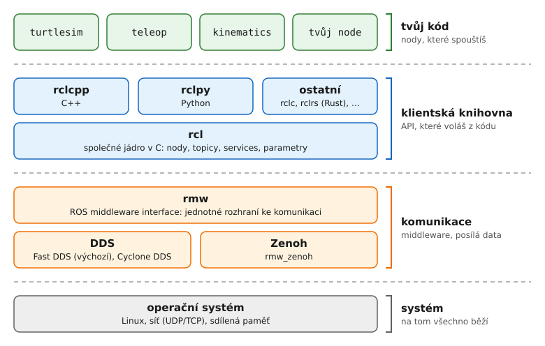
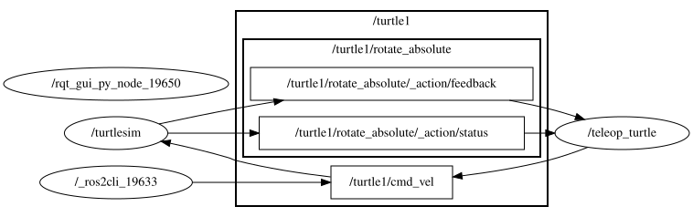
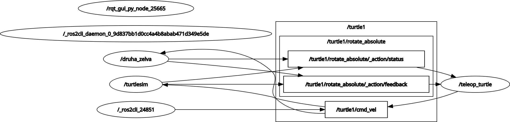

# 1 · Co je ROS 2

**Cíl:** pochopit, z čeho se skládá aplikace v ROS 2, a umět si ji prohlédnout z terminálu na želvě.

Tahle kapitola je hlavně o pochopení. Kód zatím nepíšeš, začneme s ním v kapitole 3. Příkazy ale zkoušej průběžně během čtení.

## Proč vůbec ROS

Robot se skládá z mnoha částí: ovladače motorů, kamery, lokalizace, plánování trasy, ovládání z gamepadu, vizualizace… Kdyby to byl jeden velký program, každá chyba by shodila všechno a psalo by se to strašně.

ROS proto robota rozdělí na malé samostatné programy, které si posílají data. ROS sám přitom poskytuje:
- **komunikaci**: programy se v síti (v rámci jednoho zařízení nebo i Wi-Fi sítě) najdou samy a posílají si data, i když každý je psaný v jiném jazyce nebo na jiném počítači
- **standardní zprávy**: rychlost, poloha, obrázek, mračno bodů… Kamera od jednoho výrobce a navigace od jiného si tak rozumí
- **nástroje**: výpis a nahrávání dat, vizualizace (rviz2), simulace (Gazebo)
- **hotové balíčky**: navigace, ovladače senzorů, kinematika robotických ramen

## Vrstvy



Odshora dolů:

1. **Tvůj kód.** který píšeš a spouštíš. Vyzkoušíš si ho napsat v kapitole 3 a budeš ho psát při práci na roveru. Člení se do nodes. Co je node, vysvětlíme za chvíli.
2. **Klientské knihovny** `rclpy` (Python) a `rclcpp` (C++). Tohle je API, které voláš z kódu: „vytvoř node“, „publikuj zprávu“, „zavolej mi funkci, až přijde zpráva“. Existují i další (`rclc` pro mikrokontroléry, `rclrs` pro Rust…), my zde použijeme hlavně Python.
3. **rcl** (*ROS client library*) je společné jádro napsané v C. Všechny knihovny nad ním jsou jen tenké obaly. Díky tomu se node v Pythonu chová stejně jako node v C++ a navzájem si bez problémů rozumí.
4. **rmw** (*ROS middleware interface*) je jednotné rozhraní, přes které rcl posílá data. Pod ním může být různý middleware (vrstva 5) a tvůj kód se o tom vůbec nedozví. Který se použije, určuje proměnná `RMW_IMPLEMENTATION`.
5. **DDS nebo Zenoh** zajišťují logiku komunikace zpráv. **DDS** (*Data Distribution Service*) posíláná data mezi programy v reálném čase.
Nemá žádný centrální server, takže každý program o sobě do sítě rozhlásí, co posílá a co chce přijímat, a ostatní se s ním spojí napřímo (tomu se říká *discovery*). **Zenoh** je novější alternativa. Nody se místo rozhlašování hledají přes prostředníka (*router*) a data si pak posílají napřímo, což má své výhody a nevýhody.
6. **Operační systém** pak jen posílá data z místa A na místo B.

Ty budeš pracovat skoro jen s vrstvami 1 a 2. O spodní se začneš zajímat, až se rover nebude chtít spojit s notebookem.

ROS1 fungoval hodně jinak. Měl pro komunikaci centrální server a je s ROS2 nekompatibilní.

## Příprava

Budeš potřebovat několik terminálů. V každém nejdřív `distrobox enter bmr`. V prvním spusť želvu:

```
ros2 run turtlesim turtlesim_node
```

`ros2 run <balíček> <program>` spustí program z balíčku. Balíček je složka s programy, zprávami a konfigurací, víc o něm v kapitole 2.

*Běžící program v terminálu ukončíš pomocí `Ctrl+C`.*

## Node

**Node** je jeden program (přesněji jedna jednotka v programu) s jedním úkolem. Může to být ovladač kamery, výpočet kinematiky, teleoperace. Nody o sobě navzájem nevědí. Jen posílají a přijímají data, a díky tomu jde kterýkoli z nich vyměnit, restartovat nebo spustit na jiném počítači.

Ve druhém terminálu:

```
ros2 node list
```

Mělo by se vypsat `/turtlesim`.

Spusť ve třetím terminálu ovládání ze cvičení v kapitole 0:

```
ros2 run turtlesim turtle_teleop_key
```

A znovu v druhém terminálu:

```
ros2 node list
```

Přibyl `/teleop_turtle`. Všimni si, že jméno nodu nemusí být stejné jako jméno programu (`turtle_teleop_key`).

Co node dělá, ukáže:

```
ros2 node info /turtlesim
```

Vypíše, co node **publikuje** (*Publishers*), co **odebírá** (*Subscribers*), jaké nabízí **services** a **actions**. Všechny ty pojmy postupně projdeme.

Jméno nodu jde při spuštění změnit. Takhle spustíš druhý turtlesim:

```
ros2 run turtlesim turtlesim_node --ros-args --remap __node:=druha_zelva
```

`ros2 node list` teď ukáže `/druha_zelva` i `/turtlesim`. Oba ale mají želvu `turtle1` a poslouchají stejný topic `/turtle1/cmd_vel`, takže teleop teď řídí obě najednou. Dva nody stejného typu musí mít nejen různá jména, ale i různé topicy. Jak na to, ukáže kapitola 5. Druhé okno zase zavři.

## Topic a message

**Topic** je pojmenovaný kanál, do kterého nody posílají a přijímají z něj zprávy.
Kdo do topicu posílá, je **publisher**, kdo z něj čte, je **subscriber**.

- publisherů i subscriberů může být na jednom topicu kolik chceš,
- publisher neví, kdo poslouchá (a jestli vůbec někdo), nikdo neodpovídá,
- data tečou průběžně. Např. poloha, obraz z kamery, příkazy pro motory.

```
ros2 topic list -t
```

```
/parameter_events [rcl_interfaces/msg/ParameterEvent]
/rosout [rcl_interfaces/msg/Log]
/turtle1/cmd_vel [geometry_msgs/msg/Twist]
/turtle1/color_sensor [turtlesim/msg/Color]
/turtle1/pose [turtlesim/msg/Pose]
```

`/rosout` (který se využívá pro logy) a `/parameter_events` má automaticky každý node. Zajímavé jsou `/turtle1/cmd_vel` (příkazy pro pohyb, *command velocity*) a `/turtle1/pose` (kde želva je). Podívej se do topicu:

```
ros2 topic echo /turtle1/pose
```

Teď jezdi želvou v terminálu s teleopem a sleduj, jak se mění čísla. Další užitečné příkazy:

```
ros2 topic hz /turtle1/pose          # jak často zprávy chodí
ros2 topic info -v /turtle1/cmd_vel  # kdo publikuje a kdo odebírá
```

### Message

Každý topic má pevně daný **typ zprávy** (*message*, zkráceně *msg*). Zpráva je datová struktura s pevnými názvy a typy. Typ se píše jako `balíček/msg/Název`:

```
ros2 interface show geometry_msgs/msg/Twist
```

```
Vector3  linear
        float64 x
        float64 y
        float64 z
Vector3  angular
        float64 x
        float64 y
        float64 z
```


`Twist` je rychlost: `linear` je posuvná v m/s, `angular` je otáčení v rad/s. ROS používá jednotky SI a osy podle pravidla: **x dopředu, y doleva, z nahoru**. Želva i rover tedy jedou dopředu podle `linear.x` a zatáčejí podle `angular.z`. Stejný `Twist` na `cmd_vel` řídí i Freyu.

Zprávy z balíčků `std_msgs`, `geometry_msgs` a `sensor_msgs` uvidíš všude. Než si vymyslíš vlastní typ zprávy, podívej se, jestli už neexistuje.

### Pošli zprávu sám

Turtle teleop není nic zvláštního, jen publikuje `Twist`zprávy  do `/turtle1/cmd_vel`. To zvládneš i z terminálu:

```
ros2 topic pub --once /turtle1/cmd_vel geometry_msgs/msg/Twist "{linear: {x: 2.0}, angular: {z: 1.8}}"
```

Data se zadávají ve formátu YAML. Pole, která vynecháš, jsou nulová. Želva kousek popojede a zastaví se. Aby jezdila dokola, posílej zprávu opakovaně:

```
ros2 topic pub --rate 1 /turtle1/cmd_vel geometry_msgs/msg/Twist "{linear: {x: 2.0}, angular: {z: 1.8}}"
```

Proč se po jedné zprávě zastaví? Turtlesim zastaví želvu, když jí přes sekundu nepřijde žádný příkaz. Kdyby spadl teleop nebo se přerušila Wi-Fi, skutečný robot nesmí jet dál s posledním příkazem. Stejnou pojistku má i `kinematics` na roveru.

`ros2 topic pub` nech běžet, budeš ho potřebovat v další části.

## Graf

Nody a topicy mezi sebou dohromady tvoří **graf** (*ROS graph*). Když se ptáš „proč se robot nehýbe“, může být odpověď v grafu: někdo publikuje do špatného topicu, nebo ho nikdo neposlouchá. Nakresli si graf pomocí:

```
rqt_graph
```

Vlevo nahoře přepni z *Nodes only* na **Nodes/Topics (all)**. Ovály jsou nody, obdélníky topicy a šipky vedou od publisheru k subscriberovi. V řádku **Hide** odškrtni **Debug** a obnov graf (tlačítko vlevo nahoře). Měl bys vidět zhruba tohle:



`/_ros2cli_…` je tvůj `ros2 topic pub`, i ten je node. Nody, jejichž jméno začíná podtržítkem, jsou skryté: `ros2 node list` je nevypíše, ukáže je až `ros2 node list -a`. A `rqt_graph` je schová, dokud je zaškrtnuté *Debug*. S odškrtnutým *Debug* uvidíš ještě dva nody bez šipek: `/rqt_gui_py_node_…` je samotný `rqt_graph` a `/_ros2cli_daemon_…` je pomocník na pozadí, díky kterému příkazy `ros2` odpovídají rychle. Těch si všímat nemusíš.

Rámečky `/turtle1` a `/turtle1/rotate_absolute` jsou **namespace**. Jména v ROS fungují podobně jako cesty ke složkám: `/turtle1/cmd_vel` je topic `cmd_vel` ve „složce“ `/turtle1`. Všechno, co patří první želvě, je tak pohromadě, a druhá želva může mít svůj vlastní `cmd_vel` v `/turtle2`, aniž by se jména pletla. `rqt_graph` topicy ze stejného namespace kreslí do společného rámečku. Víc o namespacech v kapitole 5.

Do `/turtle1/cmd_vel` teď publikují dva nody najednou a želva poslechne vždy tu poslední zprávu. Celkem častý zdroj chyb může být, že ti na topic publikuje něco, co nečekáš, v grafu je to ale hned vidět.

Kde je `/turtle1/pose`? Filtry *Dead sinks* a *Leaf topics* skrývají topicy, které nikdo neodebírá. Pusť v dalším terminálu `ros2 topic echo /turtle1/pose`, obnov graf a topic se objeví. Topicy `/turtle1/rotate_absolute/_action/…` patří k action, k těm se dostaneme v části Action.

Pokud ti v grafu navíc visí `/druha_zelva`, nezavřel jsi druhý turtlesim z části Node. Je vidět, že odebírá stejný `/turtle1/cmd_vel` jako `/turtlesim`:



`ros2 topic pub` teď můžeš ukončit.

## Service

**Service** je dotaz a odpověď, něco jako volání funkce na jiném nodu.
Jeden node nabízí  service (*server*), ostatní ho volají (*client*) a čekají, dokud nepřijde odpověď. Hodí se na krátké jednorázové věci: reset, přepnutí režimu...

```
ros2 service list -t
```

Uvidíš `/spawn`, `/reset`, `/clear`, `/kill`, `/turtle1/set_pen`, `/turtle1/teleport_absolute`… a pár `/turtlesim/…_parameters`, o kterých bude řeč za chvíli. Service má typ stejně jako topic, jen ze dvou částí:

```
ros2 interface show turtlesim/srv/Spawn
```

```
float32 x
float32 y
float32 theta
string name # Optional.  A unique name will be created and returned if this is empty
---
string name
```

Nad `---` je **request**, pod ním **response**.
Přidej druhou želvu:

```
ros2 service call /spawn turtlesim/srv/Spawn "{x: 2.0, y: 2.0, theta: 0.0, name: 'turtle2'}"
```

Odpověď je `name='turtle2'` a v okně je nová želva.

Novou želvu můžeš ovládat stejným teleopem. Stačí mu při spuštění přemapovat topic a kvůli přehlednosti i jméno nodu, jinak by v grafu byly dva `/teleop_turtle`:

```
ros2 run turtlesim turtle_teleop_key --ros-args --remap turtle1/cmd_vel:=turtle2/cmd_vel --remap __node:=teleop_turtle2
```

Obnov `rqt_graph`: přibyl rámeček `/turtle2` s topicem `/turtle2/cmd_vel` mezi `/teleop_turtle2` a turtlesimem. Ostatní topicy druhé želvy (`/turtle2/pose`…) zatím nikdo neodebírá, takže je filtry schovají. Všimni si ale, že `/teleop_turtle2` je pořád napojený na `/turtle1/rotate_absolute/_action/…`. Klávesy pro otáčení (`G`, `B`…) v novém teleopu proto otáčí první želvou, přemapovali jsme jen `cmd_vel`.
Service v grafu nejsou, `rqt_graph` ukazuje jen topicy.

Další service na vyzkoušení:

```
ros2 service call /turtle1/set_pen turtlesim/srv/SetPen "{r: 255, g: 0, b: 0, width: 5}"
ros2 service call /clear std_srvs/srv/Empty
ros2 service call /reset std_srvs/srv/Empty
```

`/clear` smaže čáry, `/reset` vrátí všechno na začátek.

## Action

**Action** je dlouhý úkol: „dojeď na tyto souřadnice“, „otoč se o 90°“. Klient pošle **cíl** (*goal*), server ho průběžně plní a posílá **zpětnou vazbu** (*feedback*) a na konci vrátí **výsledek** (*result*). Na rozdíl od service se dá action **zrušit** a klient mezitím nemusí jen čekat. Uvnitř je action složená z několika topiců a service. Proto jsi v `rqt_graph` viděl topicy `/turtle1/rotate_absolute/_action/feedback` a `…/status` mezi turtlesimem a teleopem.

Turtlesim má jednu action: otočení želvy na daný úhel. Teleop ji umí poslat klávesami `G B V C D E R T`, `F` otáčení zruší. Vyzkoušej to a pak:

```
ros2 action list -t
ros2 interface show turtlesim/action/RotateAbsolute
```

```
# The desired heading in radians
float32 theta
---
# The angular displacement in radians to the starting position
float32 delta
---
# The remaining rotation in radians
float32 remaining
```

Tři části: cíl, výsledek, zpětná vazba. Pošli z terminálu:

```
ros2 action send_goal --feedback /turtle1/rotate_absolute turtlesim/action/RotateAbsolute "{theta: 1.57}"
```

Během otáčení se vypisuje `remaining` a na konci výsledek.
Zkus poslat cíl a hned v teleopu zmáčknout jinou z kláves: první cíl skončí se stavem `ABORTED` a turtlesim vypíše `Rotation goal received before a previous goal finished. Aborting previous goal`.

## Parametry

**Parametr** je nastavení nodu (např. maximální rychlost, frekvence, jméno souboru). Nastavuje se při spuštění (typicky z YAML souboru) a některé jde měnit i za běhu. Parametry patří vždycky konkrétnímu nodu.

```
ros2 param list
```

```
/teleop_turtle:
  …
  scale_angular
  scale_linear
  …
/turtlesim:
  background_b
  background_g
  background_r
  holonomic
  qos_overrides./parameter_events.publisher.depth
  …
  start_type_description_service
  use_sim_time
```

Parametry jako `use_sim_time` nebo `qos_overrides…` má každý node automaticky.
Zajímavé jsou ty, které si node definuje sám.

```
ros2 param get /turtlesim background_r
ros2 param set /turtlesim background_r 150
```

Pozadí se přebarví. Všechna nastavení nodu si můžeš uložit do souboru:

```
ros2 param dump /turtlesim > zelva.yaml
```

Turtlesim ukonči a spusť ho znovu s tímto souborem:

```
ros2 run turtlesim turtlesim_node --ros-args --params-file zelva.yaml
```

Takhle se nastavuje i rover: parametry Freyi jsou v `config/freya/default.yaml`.
Za běhu se parametry čtou a mění přes service, proto jsi v seznamu service viděl `/turtlesim/get_parameters` a podobné.

## Kdy co použít

| | jak | kdy | na roveru |
|---|---|---|---|
| **topic** | proud zpráv, N:N, bez odpovědi | data, která tečou průběžně | `cmd_vel`, odometrie, kamera, stav baterie |
| **service** | dotaz -> odpověď, klient čeká | krátké jednorázové akce | reset, přepnutí režimu |
| **action** | cíl -> zpětná vazba -> výsledek, jde zrušit | dlouhé úkoly | dojeď na waypoint |
| **parametr** | hodnota v nodu, ze YAML nebo za běhu | nastavení | max. rychlost, rozměry roveru |

Když si nejsi jistý, je to skoro vždycky topic.

## Shrnutí

- `turtlesim_node` a `turtle_teleop_key` jsou dva **nody**, které o sobě nevědí.
  Teleop publikuje `Twist`zprávy do **topicu** `/turtle1/cmd_vel`, turtlesim ho odebírá.
- Každý topic má typ **message**. Zprávu jsi poslal i sám přes `ros2 topic pub`.
- Nody a topicy tvoří **graf**, ten ukáže `rqt_graph`.
- Turtlesim nabízí **services** (`/spawn`, `/reset`…), jednu **action** (`rotate_absolute`) a má **parametry**.
- Všechno to jde pod ROS 2 přes stejné vrstvy: klientská knihovna → rcl → rmw → DDS. Nody se díky DDS najdou samy, bez centrálního serveru.

Příkazy z kapitoly:

| příkaz | co dělá |
|---|---|
| `ros2 run <balíček> <program>` | spustí node |
| `ros2 node list` / `info <node>` | nody (`-a` i skryté), co node publikuje, odebírá a nabízí |
| `ros2 topic list -t` | topicy i s typy |
| `ros2 topic echo <topic>` | vypisuje zprávy |
| `ros2 topic hz <topic>` | jak často zprávy chodí |
| `ros2 topic pub <topic> <typ> "<yaml>"` | pošle zprávu (`--once`, `--rate N`) |
| `ros2 interface show <typ>` | struktura zprávy, service nebo action |
| `ros2 service list -t` / `call <service> <typ> "<yaml>"` | services a jejich volání |
| `ros2 action list -t` / `send_goal --feedback …` | actions a poslání cíle |
| `ros2 param list` / `get` / `set` / `dump` | parametry |
| `--ros-args --remap staré:=nové` | přejmenuje topic nebo node (`__node:=`) |
| `--ros-args --params-file <soubor.yaml>` | načte parametry ze souboru |
| `rqt_graph` | nakreslí graf |

Napovídání tabulátorem funguje u všech `ros2` příkazů, i pro jména topiců a typů.

## Když to nefunguje

| Problém | Řešení |
|---|---|
| `ros2: command not found` | nejsi v kontejneru: `distrobox enter bmr`, prompt musí začínat `(bmr)` |
| `ros2 node list` je prázdný, i když turtlesim běží | obnov mezipaměť: `ros2 daemon stop` a zkus znovu; ověř, že oba terminály jsou v kontejneru |
| teleop nereaguje | fokus musí být v terminálu s teleopem, ne v okně želvy |
| `Failed to populate field: … has no attribute 'x:2.0'` | za dvojtečkou v YAML musí být mezera (`x: 2.0`), celé to musí být v uvozovkách |
| `The passed message type is invalid` | překlep v typu, nech si ho doplnit tabulátorem |
| `service call` jen píše `waiting for service to become available` | turtlesim neběží, nebo je překlep ve jménu service |
| v `rqt_graph` chybí nody nebo topicy | přepni na *Nodes/Topics (all)*, v řádku *Hide* odškrtni filtry a obnov graf |
| `ros2 node list` píše `nodes in the graph that share an exact name` | běží dvakrát stejný node (např. dva turtlesimy), jeden ukonči |

---

Předchozí: [0 · Prostředí](00-prostredi.md) · Další: [2 · Workspace a balíček](02-workspace.md)
